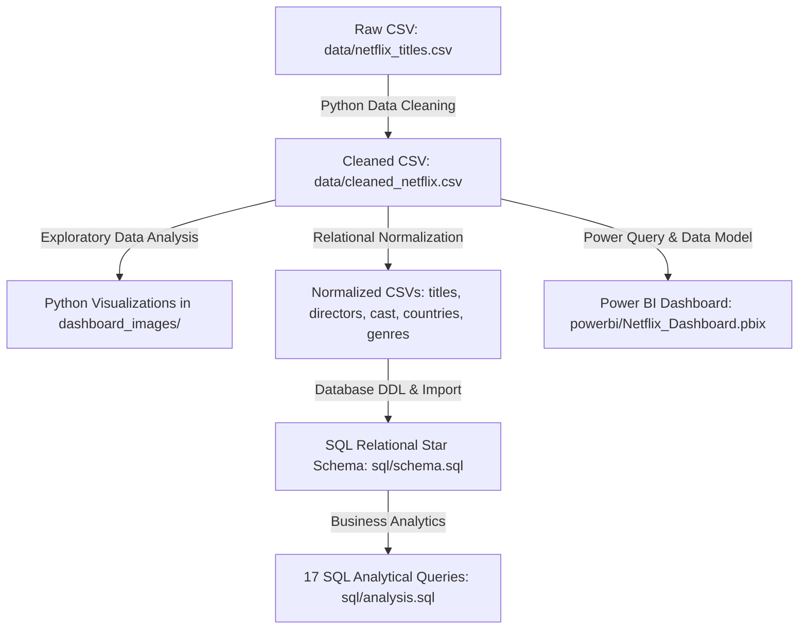
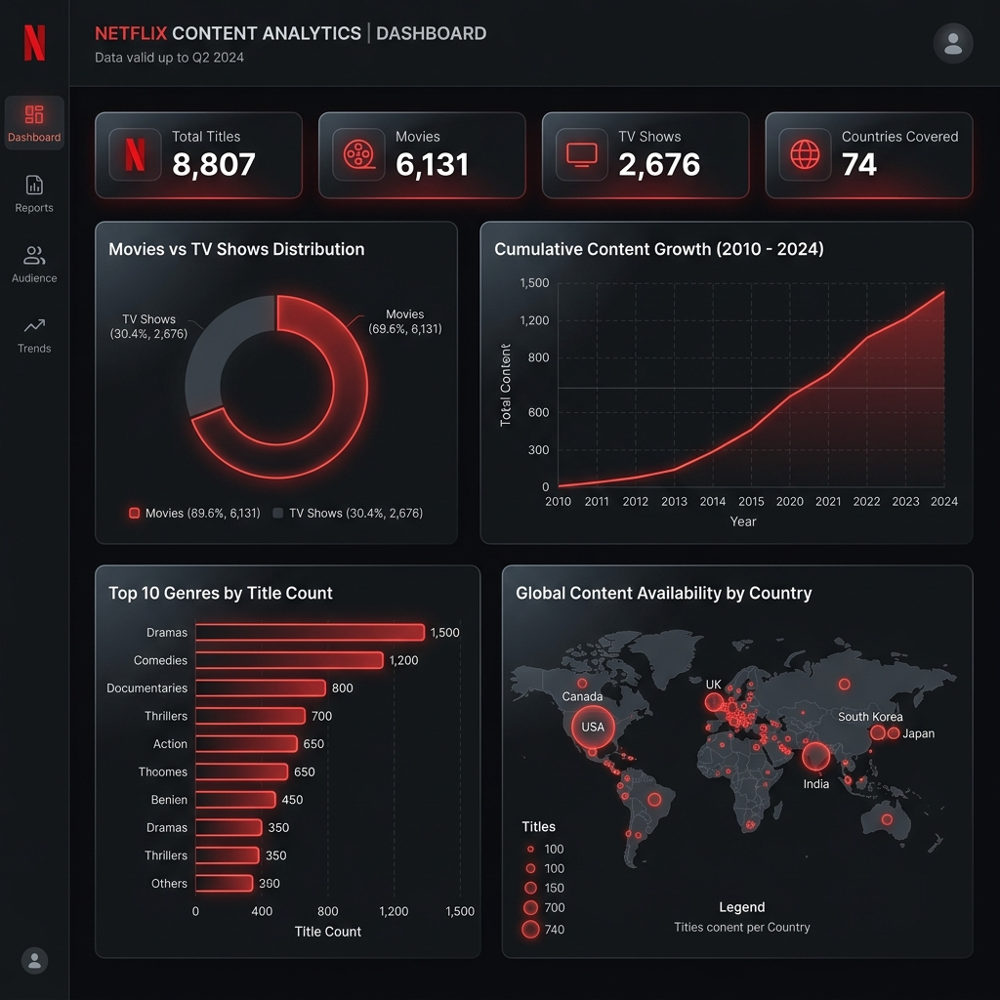

# Netflix Data Analysis Project

An end-to-end data analytics and business intelligence project exploring Netflix's global catalog of movies and TV shows. This project demonstrates Python data cleaning and exploratory data analysis (EDA), a 1st Normal Form (1NF) star schema database design with 17 analytical SQL queries, and an interactive Power BI dashboard designed with a custom dark theme matching Netflix's brand identity.

---

## Project Overview

This project showcases an enterprise-grade analytics workflow across the full data lifecycle:
1. **Cleaned & Processed** raw Netflix catalog data using Python (Pandas & NumPy) to handle missing values, resolve data types, standardize text attributes, and eliminate duplicates.
2. **Engineered Features** such as parsed date parts (`year_added`, `month_added`, `day_added`) and isolated numeric runtimes (`duration_minutes` for movies, `duration_seasons` for TV shows).
3. **Structured & Normalized** a relational database schema resolving multi-valued columns (cast, directors, countries, genres) into 1NF dimension bridge tables, and authored 17 analytical SQL queries utilizing window functions, CTEs, and multi-table joins.
4. **Designed an Interactive Power BI Dashboard** showcasing key performance indicators (KPIs), content growth trajectories, geographical distributions, and genre preferences.

---

## Tech Stack

* **Data Processing & EDA:** Python (Pandas, NumPy, Matplotlib, Seaborn)
* **Database Management:** SQL (PostgreSQL / MySQL / SQL Server / SQLite compatible DDL & DML)
* **Business Intelligence:** Power BI Desktop (DAX, Power Query, Star Schema Data Modeling)
* **Development Tools:** Jupyter Notebooks, Git

---

## Project Structure

```
Netflix-Data-Analysis/
├── dashboard_images/          # Visualizations generated by Python EDA & dashboard preview
├── data/                      # Raw, cleaned, and normalized relational datasets
│   ├── netflix_titles.csv     # Raw dataset (7,787 rows, 12 columns)
│   ├── cleaned_netflix.csv    # Cleaned flat dataset (7,777 rows, 17 columns)
│   ├── normalized_titles.csv  # Core titles table (7,777 rows, 13 columns)
│   ├── normalized_directors.csv # Director bridge table (6,115 rows)
│   ├── normalized_cast.csv    # Cast bridge table (55,884 rows)
│   ├── normalized_countries.csv # Country bridge table (9,054 rows)
│   └── normalized_genres.csv  # Genre bridge table (17,051 rows)
├── powerbi/                   # Power BI assets and design guides
│   ├── Netflix_Dashboard.pbix # Interactive Power BI dashboard report
│   └── Netflix_Dashboard_Guide.md # Step-by-step construction guide with DAX measures
├── python/                    # Data engineering and analysis scripts & notebooks
│   ├── data_cleaning.py       # Production ETL data cleaning & normalization pipeline
│   ├── data_cleaning.ipynb    # Interactive cleaning & feature engineering notebook
│   ├── run_eda.py             # Automated script generating all 8 EDA chart figures
│   ├── eda.ipynb              # Exploratory Data Analysis & visual insights notebook
│   └── create_notebooks.py    # Programmatic notebook generator utility
├── sql/                       # Relational database scripts
│   ├── schema.sql             # DDL star schema with constraints & indexes
│   ├── import_data.sql        # Direct COPY and LOAD DATA bulk ingestion scripts
│   └── analysis.sql           # 17 analytical business queries (window funcs, CTEs)
├── .gitignore                 # Excludes virtual environments, checkpoints, and cache
├── check_missing_cast.py      # Actor normalization & collation audit script
├── Netflix_Data_Analysis.pbix # Standalone Power BI dashboard binary package
├── requirements.txt           # Project library dependencies
├── resume_points.md           # Recruiter-ready ATS resume bullet points
└── README.md                  # Project documentation
```

---

## Dataset

* **Source:** [Kaggle Netflix Movies and TV Shows Dataset](https://www.kaggle.com/code/lucifierx/netflix)
* **Raw Dataset Size:** 7,787 rows and 12 columns (`data/netflix_titles.csv`).
* **Original Columns:** `show_id`, `type`, `title`, `director`, `cast`, `country`, `date_added`, `release_year`, `rating`, `duration`, `listed_in`, `description`.
* **Cleaned Dataset Size:** 7,777 rows and 17 columns (`data/cleaned_netflix.csv`) after dropping 10 rows with missing `date_added` (<0.13%) and engineering 5 numeric and date features.

---

## Workflow Architecture



---

## 1. Python Data Cleaning & Feature Engineering

Located in [python/data_cleaning.py](python/data_cleaning.py) and [python/data_cleaning.ipynb](python/data_cleaning.ipynb).

### Cleaning Actions Performed:
* **Whitespace Trimming:** Stripped all leading and trailing whitespace and embedded carriage returns across all string fields.
* **Missing Value Imputation:**
  * Replaced nulls in `director`, `cast`, and `country` with `'Unknown'`.
  * Dropped 10 records missing `date_added` (<0.13% of dataset) for chronological integrity.
  * Marked unrated records as `'Unknown'`.
* **Categorical Standardization:** Standardized the `type` column to `'Movie'` (5,377 titles) and `'TV Show'` (2,400 titles).
* **Date Conversion & Feature Extraction:**
  * Converted `date_added` into standard ISO `YYYY-MM-DD` date format.
  * Extracted discrete features: `year_added` (integer), `month_added` (name), and `day_added` (integer).
* **Duration Processing:** Split the alphanumeric `duration` field (e.g., `"90 min"`, `"2 Seasons"`) into two dedicated numeric fields:
  * `duration_minutes` (integer, populated for Movies)
  * `duration_seasons` (integer, populated for TV Shows)
* **Relational Normalization:** Exploded multi-valued comma-separated columns into dedicated 1NF relational dimension tables for SQL import.

---

## 2. Exploratory Data Analysis (EDA)

Located in [python/eda.ipynb](python/eda.ipynb) and automated via [python/run_eda.py](python/run_eda.py).

All visual charts utilize a custom Netflix dark theme (`#121212` canvas, `#E50914` Netflix Red accents) and are saved in [dashboard_images/](dashboard_images/):
* **Content Types Breakdown:** 69.1% of Netflix titles are Movies (5,377), while 30.9% are TV Shows (2,400).
* **Top 10 Genres:** *International Movies* (2,437 titles), *Dramas* (2,106 titles), and *Comedies* (1,553 titles) represent the largest catalog share.
* **Content Growth Trajectory:** Cumulative growth accelerated rapidly from 2015 to 2021, with Movies scaling at a faster rate than TV Shows.
* **Movie Duration Distribution:** Feature film runtimes center between 85 and 110 minutes (mean: 99.31 minutes, min: 3 min, max: 312 min).
* **TV Show Seasons Distribution:** Over 70% of TV series on the platform consist of only 1 Season (mean: 1.76 seasons), showing a strong platform emphasis on limited series and freshman acquisitions.

---

## 3. SQL Relational Database Analysis

Located in [sql/schema.sql](sql/schema.sql), [sql/import_data.sql](sql/import_data.sql), and [sql/analysis.sql](sql/analysis.sql).

### Normalized Schema Design (1NF Star Schema)
To resolve repeating groups and comma-separated arrays, the database separates content into a central titles table and four relational bridge tables:
* **`netflix_titles`** (7,777 rows) – Core attributes, dates, and runtimes.
* **`netflix_directors`** (6,115 rows) – Bridge mapping titles to director(s).
* **`netflix_cast`** (55,884 rows) – Bridge mapping titles to actor(s).
* **`netflix_countries`** (9,054 rows) – Bridge mapping titles to production country/countries.
* **`netflix_genres`** (17,051 rows) – Bridge mapping titles to genre(s).

### 17 Analytical Queries Included:
1. **Movie vs. TV Show Count:** Library breakdown and percentage share.
2. **Top 10 Producing Countries:** Volume distribution handling multi-country co-productions.
3. **Movies by Country:** Filters specifically for feature film production.
4. **Top 10 Directors:** Most frequent filmmakers (led by Jan Suter with 21 titles).
5. **Most Common Genres:** Total titles per genre and platform market coverage.
6. **Year-wise Releases:** Distribution of titles based on original theatrical/broadcast year.
7. **Content Added Every Year:** Cumulative platform scaling trajectory.
8. **Content Added Seasonality by Month:** Month-by-month addition volume (led by December with 833 titles).
9. **Content Ratings Distribution:** Age demographic classification (TV-MA, TV-14, PG-13).
10. **Most Frequent Content Rating:** Overall modal rating across the library (TV-MA: 2,861 titles).
11. **Average Movie Duration:** Runtime metrics (Average: 99.31 min, Min: 3 min, Max: 312 min).
12. **Top 10 Longest Movies:** Outlier runtime analysis (led by *Black Mirror: Bandersnatch* at 312 min).
13. **Top 10 TV Shows with Most Seasons:** Longest-running series (*Grey's Anatomy*, *NCIS*, *Supernatural*).
14. **Top 15 Most Common Actors:** Most frequent cast appearances (led by Anupam Kher with 42 appearances).
15. **Latest 10 Added Titles:** Chronologically ordered by `date_added DESC` (*A Monster Calls*, *Radium Girls*).
16. **Top 5 Drama Directors:** Multi-table join connecting directors, titles, and genres.
17. **Countries Producing Most Movies vs. TV Shows:** CTE comparing movie and TV show ratios by country.

---

## 4. Power BI Dashboard

Located in [powerbi/Netflix_Dashboard.pbix](powerbi/Netflix_Dashboard.pbix) (and [Netflix_Data_Analysis.pbix](Netflix_Data_Analysis.pbix)). Detailed DAX formulas and build steps are documented in [powerbi/Netflix_Dashboard_Guide.md](powerbi/Netflix_Dashboard_Guide.md).

### Verified KPI Metrics:
* **Total Titles:** 7,777
* **Total Movies:** 5,377
* **Total TV Shows:** 2,400
* **Average Movie Duration:** 99.31 minutes
* **Average TV Seasons:** 1.76 seasons
* **Latest Content Added:** 2021

### Visual Components:
* **KPI Card Visuals:** High-level summary cards for fast executive scanning.
* **Donut Chart:** Proportion of content by type (Movies vs. TV Shows).
* **Line Chart:** Annual trend of content additions over time.
* **Clustered Column Charts:** Content breakdown by age rating and shows added per month.
* **Horizontal Bar Charts:** Ranked Top 10 Directors, Top 10 Actors, Top 10 Genres, and Top 10 Countries.

### Dashboard Mockup:


---

## Installation & Setup

### 1. Clone the Repository
```bash
git clone https://github.com/yourusername/Netflix-Data-Analysis.git
cd Netflix-Data-Analysis
```

### 2. Set Up Python Environment
```bash
# Create and activate virtual environment
python -m venv venv

# Windows (PowerShell):
venv\Scripts\Activate.ps1

# macOS / Linux:
source venv/bin/activate

# Install required dependencies
pip install -r requirements.txt
```

### 3. Run Data Cleaning & Ingestion Pipeline
```bash
python python/data_cleaning.py
```
This generates `data/cleaned_netflix.csv` along with all 5 normalized relational CSV tables in `data/`.

### 4. Run Exploratory Data Analysis (EDA)
```bash
python python/run_eda.py
```
This generates and saves all 8 visualization charts into `dashboard_images/`.

### 5. SQL Database Setup
1. Create a database in PostgreSQL or MySQL.
2. Execute `sql/schema.sql` to generate tables, primary/foreign key relationships, and performance indexes.
3. Follow the bulk ingestion instructions in `sql/import_data.sql` to import the CSV files.
4. Execute analytical queries from `sql/analysis.sql`.

### 6. Power BI Dashboard
1. Open Power BI Desktop.
2. Open [powerbi/Netflix_Dashboard.pbix](powerbi/Netflix_Dashboard.pbix).
3. If prompted to refresh data sources, point the `cleaned_netflix` source to your local `data/cleaned_netflix.csv`.

---

## Future Improvements

* **NLP Sentiment Analysis:** Classify movie/show descriptions by emotional tone and sentiment polarity.
* **Recommendation System:** Build a content-based filtering model in Python using cosine similarity over title overviews and genres.
* **Automated Cloud ETL:** Package the cleaning script into an Apache Airflow or Prefect pipeline to fetch and update catalogs on a scheduled basis.
